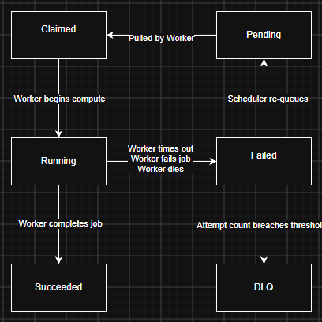

1. GOALS AND NON-GOALS
The goal of this project is to build a distributed compute grid performing Monte Carlo simulations on generated portfolios. No Kubernetes, no Swarm, no multiple coordinators, Just raw Linux, containers, python and a db.

Another goal of this project is to build observability for the compute grid on an infrastructure and application level. 

2. OVERVIEW
The distributed compute grid will be made up of the coordinator and workers on the same server to start with.

The coordinator will run three services. 
The scheduler which recieves and writes jobs, and picks up failed jobs for reassignment
The reconciler, which will reconcile the desired and available workers, the failed and healthy workers, and stuck/redundant jobs 
The failure detection service to check on the heartbeats of workers and mark workers as dead or stuck
Workers accepting a job will get a lease for that job, the lease gets refreshed as long as it's making progress? 

Workers will run two services
Heartbeat - will ping the scheduler every 10 seconds to prove node liveness and also report job progress
Monty - will perform the actual simulation and report iteration #

DB

Observability
ELK or Grafana
Logs, and metrics

3. DATA MODEL
Tables:
Jobs
ID, state, worker_id, lease_initiation_timestamp, last_progress_timestamp, error, attempt_count, attempt_id

Workers
ID, job_id, last_seen

Attempts
attempt_id, job_id, worker_id, status, error, last progressed?

4. STATE MACHINE

5. PROTOCOL
claim request- {"worker_id": id, "operation": claim} (increment attempt)
claim response- {"job_id": job_id, "attempt": #, "payload": payload} (increment attempt)
heartbeat - worker reaches out to coordinator with {"worker_id": id, "status": status, "job_id": id, "attempt": #, "progress": progress}
complete - worker reaches out to coordinator with {"worker_id": id, "job_id": job_id, "attempt": #, "result": result}
fail - {"worker_id": id, "job_id": job_id, "attempt": #, "error": error}
drop - {"job_id": job_id, "operation": drop}

6. FAILURE MODES
failure, detected, what happens
worker dies, no heartbeat for 45s, worker killed + attempts incremented + worker added to attempt list + job marked pending 
job hangs, no progress for 60s, job dropped + attempts incremented + worker added to attempt list + job marked pending
zombie worker, job comes in completed with an incorrect attempt#, don't accept a result if the attempt count is different than the incoming result + kill worker?
poison job, attempt count exceeded, job moved to DLQ
coordinator restart, no detection just a defined startup process, heartbeat grace period + take stock of jobs
db down, coordinator fails to read/write from db, create offline results file for replay later
network partition, generally discovered by seeing a zombie worker, do zombie things
sigterm, Recieved by python, graceful shutdown + mark job as failed/interrupted
claimed but not started, job will be msrked as dead because no progress gets made after 60s, increment attempts + mark pending

7. DECISIONS
HTTP for transport seems easy. Easy to curl, log and debug.

coordinator startup sets a 60 second grace period for worker liveness, and checks db to see what jobs are running or claimed

Coordinator will write completed jobs to a file to be replayed into the database on reconnect
Coordinator will retry writing as long as there's a file holding results
It's okay to retry completed results because the DB will reject if the attempt is wrong

8. OPEN QUESTIONS